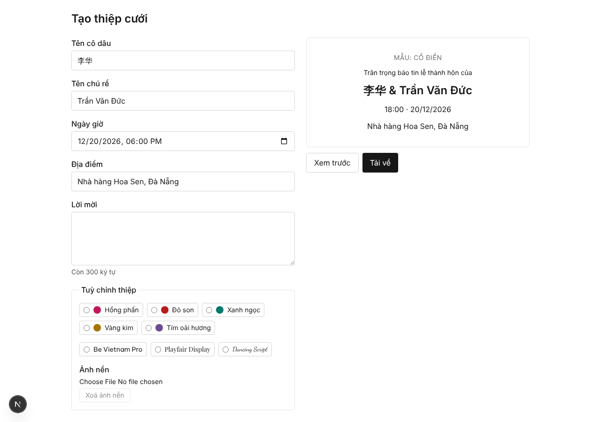

# 🐛 [bug] download: PNG file name drops non-Latin names

Bug found while analysing [super-board #4](https://github.com/toinguyen-agilityio/super-board/issues/4) (vague point Q1 in [issue-04.md](issue-04.md)), then reproduced in the running app (`npm run dev`, Chromium) by clicking through the UI. Written in super-board's bug format (`writing-standard.md` § 3) and checked with `super-qa-file-bug.sh --check-body`.

**Ticket:** https://github.com/toinguyen-agilityio/super-board/issues/11

## Problem
When the bride's or groom's name has no Latin letters (Chinese, Korean, emoji…), "Tải về" saves the PNG without that name. The preview shows `李华 & Trần Văn Đức`, but the file is called `thiep-cuoi--Tran-Van-Duc.png`, so the couple and their guests cannot tell whose invitation it is.

## Context
- **Where:** editor, `/tao?mau=co-dien`, "Tải về" button
  - a. Open `http://localhost:3000/`
  - b. Click the "Cổ điển" template card
  - c. Tên cô dâu: `李华`
  - d. Tên chú rể: `Trần Văn Đức`
  - e. Ngày giờ: `20/12/2026 18:00`
  - f. Địa điểm: `Nhà hàng Hoa Sen, Đà Nẵng`
  - g. Click "Tải về" and read the saved file name
- **Who:** a couple where at least one partner has a non-Latin name (e.g. mixed-nationality weddings)

Same steps with other names (each run once in the browser):

| Tên cô dâu | Tên chú rể | Saved file name | Result |
|---|---|---|---|
| `李华` | `Trần Văn Đức` | `thiep-cuoi--Tran-Van-Duc.png` | ❌ bride missing |
| `김민지` | `Park Ji-hoon` | `thiep-cuoi--Park-Ji-hoon.png` | ❌ bride missing |
| `😀` | `🎉` | `thiep-cuoi--.png` | ❌ both missing |
| `Nguyễn Thị Hằng` | `Trần Văn Đức` | `thiep-cuoi-Nguyen-Thi-Hang-Tran-Van-Duc.png` | ✅ OK |

## Evidence

12 rows · reproduced in the browser on staging · 3 of 4 inputs fail

| Row | Value |
|---|---|
| Error + stack | n/a — no error thrown; the download succeeds with a wrong name. Likely cause: `slug()` in `lib/download.ts` keeps only `[A-Za-z0-9-]` |
| Request / trace ID | n/a — client-side only, no request |
| Sentry | n/a — Sentry not set up in this project |
| PostHog replay | n/a — PostHog not set up in this project |
| Logs | n/a — browser console not captured in this run |
| Screenshots |  |
| HAR / API sample | n/a — no network call; the PNG is built in the browser |
| Env + release | local `npm run dev` · `staging` @ `b2071a8` · Chromium · 1280×900 |
| First / last seen | 14/10/2026 · 14/10/2026 |
| Users affected | n/a — no analytics; any couple with a non-Latin name |
| Steps | 1. open `/` 2. click "Cổ điển" 3. bride `李华`, groom `Trần Văn Đức`, any valid date and venue 4. click "Tải về" |
| Expected / actual | `thiep-cuoi-李华-Tran-Van-Duc.png` (or another name that keeps the bride) / `thiep-cuoi--Tran-Van-Duc.png` |

## Fix
Keep every name in the file name, so no part of it is empty. Open question for the PO: keep non-Latin letters as typed (`thiep-cuoi-李华-...`) or fall back to a placeholder (`thiep-cuoi-co-dau-...`)?

## Acceptance Criteria
- [ ] With bride `李华` and groom `Trần Văn Đức`, "Tải về" saves a file whose name has no empty part (no `--`)
- [ ] A name made only of emoji or symbols still produces a non-empty part in the file name
- [ ] `Nguyễn Thị Hằng` + `Trần Văn Đức` still gives `thiep-cuoi-Nguyen-Thi-Hang-Tran-Van-Duc.png`
- [ ] Characters unsafe in file names (`/ \ : * ? " < > |`) are still removed
- [ ] A unit test in `lib/download.test.ts` covers the non-Latin and emoji cases

## Risk
🟢 **Low** · only the download file name changes; the PNG content and the editor are untouched

## Blocked by
- None.
